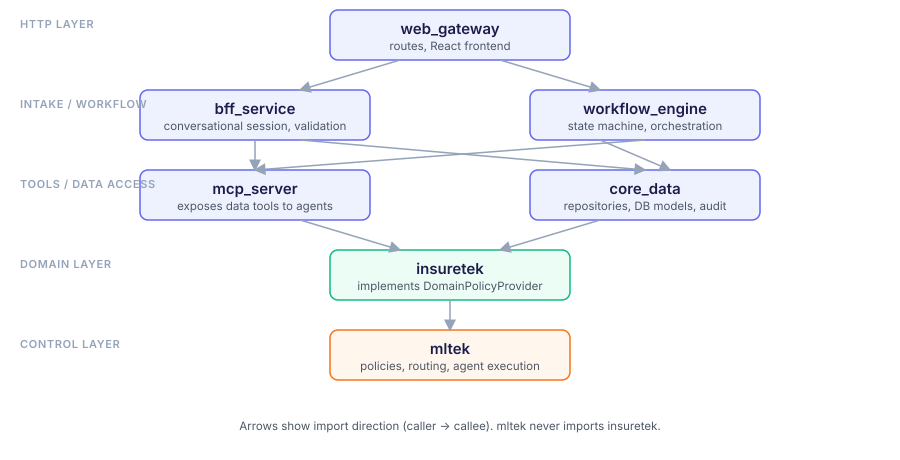
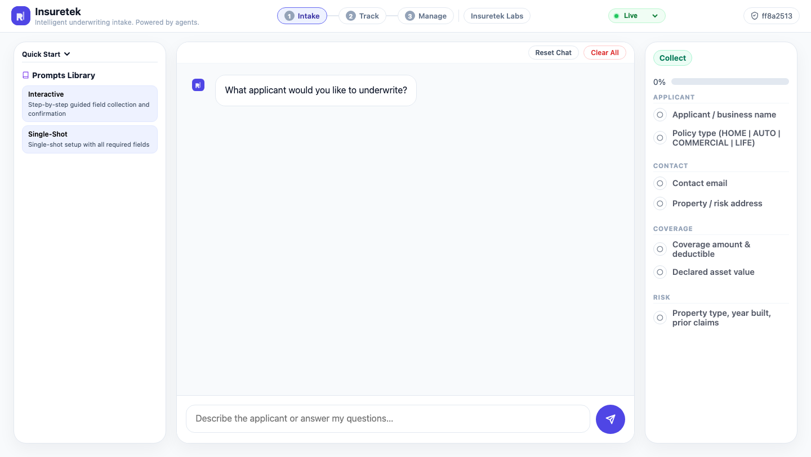
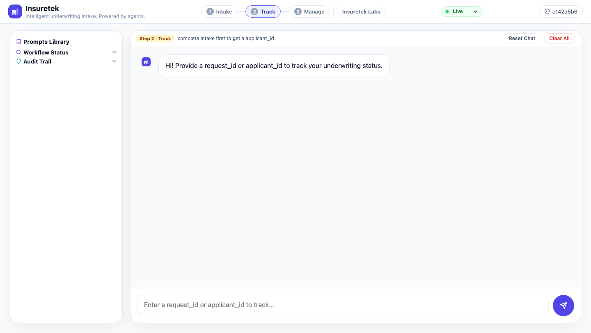
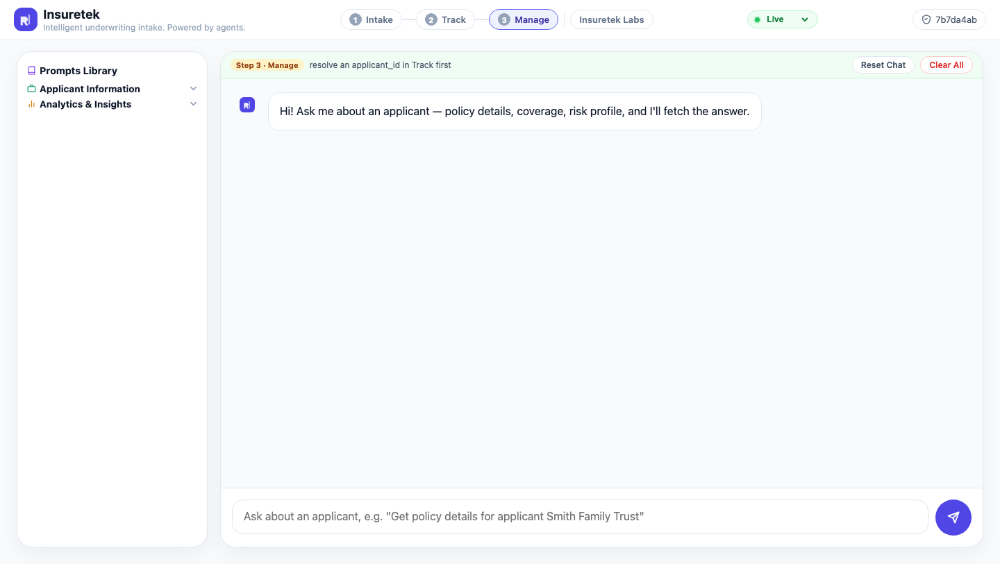

# Insuretek

Insuretek automates applicant onboarding for insurance products by combining
conversational intake, policy-driven validation, and workflow orchestration
with semantic decision support.

- **Conversational intake** — a chat-driven session collects applicant data
  incrementally, validating and persisting drafts as the conversation
  progresses rather than requiring a single large form submission.
- **Policy-driven validation** — every request passes through layered policy
  gates (prompt injection detection, rate limiting, compliance/guardian
  checks, cost and token budgets) before and after agent execution, so
  validation rules can evolve independently of the conversation or workflow
  code.
- **Workflow orchestration** — a state machine drives applicants through the
  onboarding steps, enforcing valid state transitions, supporting
  asynchronous gate checks (e.g. underwriting approvals), and allowing flows
  to be safely interrupted and resumed or retried.
- **Semantic decision support** — an intent resolver routes each request to
  the right specialized agent (keyword match → semantic router → LLM intent
  classifier) and can synthesize agent output into a coherent response,
  giving the system reasoning capability beyond fixed scripted flows.

Together these layers aim for onboarding that is fully automated end-to-end,
but remains auditable, safe to retry, and able to support human review or
approval steps when a flow requires one.

For the full architecture, component design, and policy details, see
[design/Design.md](design/Design.md).

## Architecture



## Screenshots

| Intake | Track | Manage |
|---|---|---|
|  |  |  |

## Package structure

| Package | Role |
|---|---|
| `mltek` | Control layer — framework, policies, routing, agent execution |
| `insuretek` | Domain layer — implements the `mltek` domain provider interface |
| `core_data` | Data access layer — repositories, DB models, audit persistence |
| `bff_service` | Intake layer — conversational session handling, prompt validation |
| `mcp_server` | MCP tool server — exposes data tools to agents |
| `workflow_engine` | Workflow state machine and orchestration |
| `web_gateway` | HTTP layer — routes, React frontend |

## Requirements

- Python >= 3.11
- [uv](https://github.com/astral-sh/uv) (or pip) for dependency management
- Node.js/npm (for the React frontend under `src/web_gateway/react`)
- Docker, for running DynamoDB Local and the MCP services via `docker-compose.yml`

## Setup

```bash
uv sync
# or: pip install -r requirements.txt
```

## Running locally

```bash
./run.ksh
```

This builds the React UI and starts the MCP servers and web gateway on
`http://localhost:6001`.

Alternatively, run everything via Docker Compose:

```bash
docker-compose up --build
```

## Testing

```bash
pytest
```
